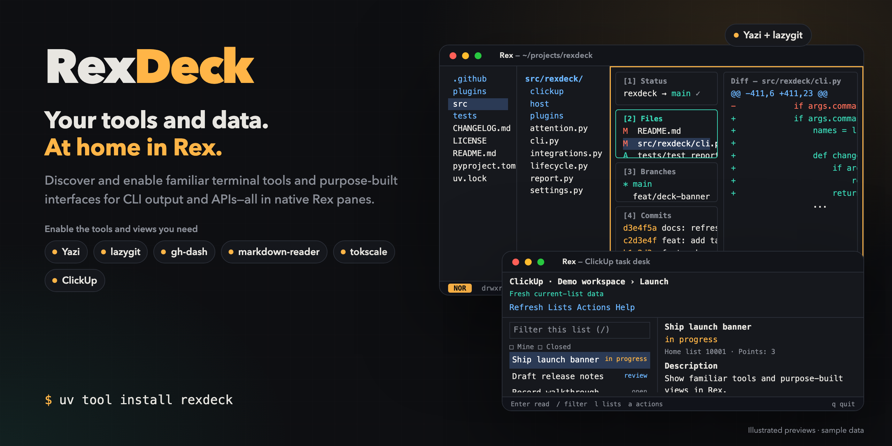

# RexDeck



**Your tools and data, at home in Rex.**

Discover and enable familiar terminal tools and purpose-built interfaces for CLI output and APIs—all in native Rex panes.

Keep the TUIs you already use, and add focused views over the commands and APIs behind your workflow. Each integration has its own setup and controls; ClickUp is one example of an existing API presented through a RexDeck interface.

Choose what you need, open it from Rex, and return to your invoking terminal when you quit a hosted pane. Installing RexDeck does not enable a suite of tools or replace your existing applications.

## Getting started

You need **Rex already running, Python 3.12+ and [uv](https://docs.astral.sh/uv/)**. The qualified platform is **macOS arm64 with Rex API revision 10 as the baseline**, not an exact-version gate. Other platforms and remote/multi-device operation are not yet qualified.

Install RexDeck, select your Rex configuration/server, and see the available integrations:

```sh
uv tool install --default-index https://pypi.org/simple rexdeck
rexdeck setup
rexdeck plugins
```

Start with the built-in [ClickUp task desk](https://github.com/Mathews-Tom/RexDeck/blob/main/plugins/clickup/README.md), which needs no separate TUI executable:

```sh
rexdeck enable clickup
```

Open **RexDeck ClickUp** from Rex's command palette. The [ClickUp guide](https://github.com/Mathews-Tom/RexDeck/blob/main/plugins/clickup/README.md#select-and-enable) covers token setup and first-run workspace/list selection. Task changes require an explicit proposal review; the pane is write-capable, not a sandbox.

Already use Yazi and lazygit? Enable both together:

```sh
rexdeck enable files git
```

Install each selected upstream tool yourself first; the [dependency guide](#selected-dependencies) lists qualified versions. RexDeck never installs Rex, Python, uv or upstream tools. Pick a [pane placement and size](#pane-placement-and-size), and leave everything else disabled.

## Explore the deck

| Pane plugin | Built with | What you can do |
| --- | --- | --- |
| [ClickUp](https://github.com/Mathews-Tom/RexDeck/blob/main/plugins/clickup/README.md) | RexDeck interface for the ClickUp API, powered by Textual | Browse a list or filtered Space queue, read Markdown details/comments and review guarded task changes across lists |
| [Files](https://github.com/Mathews-Tom/RexDeck/blob/main/plugins/files/README.md) | Unmodified Yazi | Browse, preview and manage files |
| [Git](https://github.com/Mathews-Tom/RexDeck/blob/main/plugins/git/README.md) | Unmodified lazygit | Inspect, stage and commit in the invoking repository/worktree |
| [Markdown](https://github.com/Mathews-Tom/RexDeck/blob/main/plugins/markdown/README.md) | Unmodified markdown-reader | Read Markdown with in-pane Mermaid diagrams |
| [Usage](https://github.com/Mathews-Tom/RexDeck/blob/main/plugins/usage/README.md) | Unmodified tokscale | Explore machine-wide token usage, models, sessions and projects for omp, with upstream online refresh |
| [GitHub](https://github.com/Mathews-Tom/RexDeck/blob/main/plugins/github/README.md) | Unmodified gh-dash | Work with repository-scoped PRs/issues using an explicit host/account |
| [Viewer](https://github.com/Mathews-Tom/RexDeck/blob/main/plugins/viewer/README.md) | Yazi, pdftoppm and resvg | Preview PDF pages, JPG, PNG and SVG through Rex Kitty graphics |
| [Actions](https://github.com/Mathews-Tom/RexDeck/blob/main/plugins/actions/README.md) | RexDeck Textual view for GitHub CLI 2.97+ | Read workflow runs, jobs and job-log tails without GitHub writes |
| [Containers](https://github.com/Mathews-Tom/RexDeck/blob/main/plugins/containers/README.md) | Unmodified lazydocker 0.25.2 | Inspect Docker containers, logs and stats using the existing context |
| [Dashboard](https://github.com/Mathews-Tom/RexDeck/blob/main/plugins/dashboard/README.md) | Unmodified Dashbrew 1.2.0 | Open a selected trusted JSON board with script and API data |
| [Dependencies](https://github.com/Mathews-Tom/RexDeck/blob/main/plugins/deps/README.md) | RexDeck Textual view for deps.dev and OSV | Browse public package dependencies, licenses and known advisories without scanning a repository |
| [Disk](https://github.com/Mathews-Tom/RexDeck/blob/main/plugins/disk/README.md) | Unmodified dua 3.0.1 | Explore directory disk usage; upstream deletion remains available |
| [Focus](https://github.com/Mathews-Tom/RexDeck/blob/main/plugins/focus/README.md) | Unmodified pomo 1.2.1 | Start a work timer using trusted invoking-directory settings |
| [HTTP](https://github.com/Mathews-Tom/RexDeck/blob/main/plugins/http/README.md) | Unmodified Slumber 5.4.4 | Send HTTP requests and inspect responses |
| [Images](https://github.com/Mathews-Tom/RexDeck/blob/main/plugins/images/README.md) | RexDeck Textual view for public OCI registries | Browse anonymous public image tags, digests and platforms without downloading blobs |
| [Inbox](https://github.com/Mathews-Tom/RexDeck/blob/main/plugins/inbox/README.md) | RexDeck Textual view for GitHub CLI | Read account-scoped unread notifications with filters and explicit refresh |
| [JSON](https://github.com/Mathews-Tom/RexDeck/blob/main/plugins/json/README.md) | Unmodified jless 0.9.0 | Collapse and search an explicitly selected JSON file |
| [Logs](https://github.com/Mathews-Tom/RexDeck/blob/main/plugins/logs/README.md) | Unmodified lnav 0.14.1 | Filter, query and navigate selected local logs |
| [Music](https://github.com/Mathews-Tom/RexDeck/blob/main/plugins/music/README.md) | Unmodified spotify_player 0.25.2 | Browse Spotify playlists and control playback |
| [Processes](https://github.com/Mathews-Tom/RexDeck/blob/main/plugins/procs/README.md) | Unmodified dekit 0.10.3 | Run tasks from an explicitly selected trusted dekit.yaml |
| [Redis](https://github.com/Mathews-Tom/RexDeck/blob/main/plugins/redis/README.md) | Unmodified redis-tui 1.0.48 | Browse Redis keys, values, TTLs and server metrics |
| [Slides](https://github.com/Mathews-Tom/RexDeck/blob/main/plugins/slides/README.md) | Unmodified presenterm 0.16.1 | Present an explicitly selected Markdown deck |
| [SQL](https://github.com/Mathews-Tom/RexDeck/blob/main/plugins/sql/README.md) | Unmodified Harlequin 2.17.0 | Query a selected SQLite database opened with `--read-only` (typed SQL can still write other local SQLite files) |
| [System](https://github.com/Mathews-Tom/RexDeck/blob/main/plugins/system/README.md) | Unmodified bottom 0.15.0 | Monitor the machine with read-only controls |
| [Tables](https://github.com/Mathews-Tom/RexDeck/blob/main/plugins/tables/README.md) | Unmodified VisiData 3.5 | Explore selected CSV, TSV, JSON or JSONL tables; editing remains available |

The hosted TUIs remain upstream projects with their own licenses, settings and capabilities. Purpose-built panes adapt supported commands and APIs to the Rex workspace. Plugin-specific setup, controls and limitations live in the linked guides.

### Built-in CLI extensions

`rexdeck plugins` lists the 25 selectable pane plugins above. **`attention` is a built-in CLI command, not a pane plugin**, so it does not appear in that list and there is no `rexdeck enable attention` step. After `rexdeck setup`, explore it with:

```sh
rexdeck attention --help
rexdeck attention list
```

The [attention guide](https://github.com/Mathews-Tom/RexDeck/blob/main/plugins/attention/README.md) covers explicitly observing a terminal's reported status and navigating back to that exact terminal after revalidation. This is an on-demand CLI, not a visual dashboard or background monitor. Optional Claude Code/Codex provider hooks are qualified with real subagent events from both providers; an omp hook interface is still missing.

### A look inside

[](https://github.com/Mathews-Tom/RexDeck/blob/main/assets/rexdeck-launch.mp4)

[Watch or download the MP4](https://github.com/Mathews-Tom/RexDeck/blob/main/assets/rexdeck-launch.mp4) · [Editable media sources](https://github.com/Mathews-Tom/RexDeck/tree/main/assets/source/)

The banner and animation are stylized illustrations with fictional sample data, not live screen recordings. The media deliberately omit version numbers.

### Help cover more environments

Feedback and PRs are welcome, especially for environments the maintainer cannot currently qualify:

- **Linear:** no integration yet; the maintainer has no Linear account to qualify one. Follow [Adding an integration](#adding-an-integration) and exercise real Linear data.
- **GitHub Enterprise Server or multiple GitHub accounts:** explicit host/repository/account checks are implemented, but only `github.com` with one account has been exercised.
- **A second ClickUp account or workspace:** isolation has test coverage and a deliberate account-mismatch check, not a second real account.

Include what you ran and what you observed in an issue or PR. The [development guide](#development) covers local checks.

## Usage and configuration

Published releases are available on [PyPI](https://pypi.org/project/rexdeck/). For changes merged after a release, pin an exact public source commit rather than a moving branch:

```sh
uv tool install "rexdeck @ git+https://github.com/Mathews-Tom/RexDeck@<full-commit-sha>"
```

Installing or upgrading replaces only the RexDeck package. If an upgrade changes the bundled host, `status` reports a refresh `fault` for previously enabled integrations; run `rexdeck enable <id>` for each one. A missing selected tool reports `missing-dependency` instead: restore that tool first, then rerun `rexdeck enable <id>`. Integrations you never enabled stay unselected.

The installed command works from any directory; the package includes the shared native action and Python launcher for every integration. No shell wrapper, `RD_*` variables or developer checkout is needed. Ensure the tool executable directory reported by `uv` is on `PATH`.

`setup` remembers the selected Rex configuration and running server without changing Rex configuration. Interactive setup asks for approval before saving a personal-server target. Use `enable <id> [<id> ...]` for one or more integrations (ids from `rexdeck plugins`), `status [<id>]` to inspect ownership/registration, and `disable <id> [<id> ...]` to remove only the named integrations. With several names, each one is enabled or disabled independently in the order given; a failure is reported in that integration's row while the others still change, and the command exits nonzero if any failed. An unknown name refuses the whole command before anything changes. `--placement`/`--size` apply to every named integration; put them before or after the list of names, not between names. At a terminal, `enable`, `disable`, `status` and `plugins` print a table; add `--json` (or pipe the output) for JSON. A single name keeps the single-integration JSON document. Unqualified `status` reports every integration, retaining healthy results alongside an integration-specific fault if a sibling cannot be inspected. See the plugin READMEs for prerequisites, capabilities, updates, and removal.

Each integration row's `state` is one of: `disabled` (not selected, or turned off), `ready` (its native action is registered in the running Rex; this says nothing about whether the upstream tool is currently open), `missing-dependency` (an applied integration's tool is not on the current `PATH`; `enabled` shows whether it is turned on. Make the tool available, reinstalling it yourself if it was removed, then rerun `status`, or `rexdeck enable <id>` if its path changed), `conflict`, or `fault` (ownership, refresh or registration problem, with an `error`). `plugins` additionally reports `not-configured` rows before setup. Command-level errors, including no saved target or an unknown/old receipt for `status <id>`, print `failed`. `missing-dependency`, `conflict`, `fault` and `failed` exit nonzero.

Run `rexdeck plugins` to list every available plugin shipped with this installation and its current state. At a terminal it prints a table (plugin, state, tool and qualified versions, pane layout) followed by a **Needs attention** section that states each problem and its fix once, even when several plugins share it. Add `--json`, or pipe the output, for the full JSON document; `status` behaves the same way. Configured JSON rows include `enabled: true` or `enabled: false`; before setup, rows report `not-configured` rather than guessing that a target is disabled. Since 0.2.0, configured rows also report the saved pane `layout`, and every row's `integration` field discloses the hosted tool, qualified versions, upstream license, launch context, write/network/process capabilities and default layout. Plugin inspection faults remain visible alongside healthy sibling rows and return a nonzero exit status. Listing never enables integrations or installs dependencies. Planned integrations are not included.

ClickUp's tool label carries a `[RexDeck UI]` badge identifying its RexDeck-authored interface. Other tool labels remain unannotated, and JSON output is unchanged.

`rexdeck attention observe --session session:… --block block:… --project my-project` captures one explicitly identified terminal's native OSC 7501 records and exit result. `rexdeck attention list --project my-project` shows retained source, timestamps, freshness and bound/unbound state; `rexdeck attention jump <observation-id>` revalidates the exact server incarnation/session/block before focus. This native extension needs setup but no `enable`, upstream executable, hooks or daemon. A terminal binding is not a provider agent identity. See [native attention](https://github.com/Mathews-Tom/RexDeck/blob/main/plugins/attention/README.md) for limits and privacy.

Refresh a retained row explicitly with `rexdeck attention observe <observation-id>`: **list → observe ID → jump ID**, without a watcher. Observations live under the setup-owned workspace's `attention/` directory. Untrusted status text and each serialized row are capped and disclose `truncated: true`; a newly observed server incarnation invalidates all older-instance rows on that endpoint without changing their last observed placement.

Optional `rexdeck attention hook claude-code` / `codex` receivers accept bounded stdin hook JSON without retaining message content or transcript paths. Provider rows preserve parent/child IDs, receipt freshness, `started`/`stopped` and `outcome: unknown`; `list --provider … --parent … --agent …` filters them and groups their reported parents. Exact inherited Rex bindings reuse native jump revalidation; outside Rex they are unbound. Hooks are never auto-installed. See the [provider-specific config/trust/rollback instructions](https://github.com/Mathews-Tom/RexDeck/blob/main/plugins/attention/README.md#optional-provider-hooks-d11) and separate provider retention limits. Native storage stays schema 1 and keeps its independent capacity; `attention clear --provider claude-code|codex` frees only that provider's retained space after hook removal.

If provider evidence is damaged, `attention list` preserves native rows and reports `provider_state: fault` plus `provider_error` with a nonzero exit. Provider clearing reports that fault too; see the [scoped recovery instructions](https://github.com/Mathews-Tom/RexDeck/blob/main/plugins/attention/README.md#provider-store-faults-and-explicit-recovery) rather than deleting native attention data. A provider jump releases its store lock before native verification/focus calls so concurrent hook receipts are not blocked by navigation.

The uv-managed package remains the runtime source. Setup freezes the app data root from `$XDG_DATA_HOME/rexdeck` (default `~/.local/share/rexdeck`); each integration deploys `plugins/<id>/rexdeck_<id>.lua` there with an independently owned tracked loader in Rex's `init.lua`. Approved preferences remain in `$XDG_CONFIG_HOME/rexdeck/config.json`. Files receipt/lock paths remain in the saved `$XDG_STATE_HOME/rexdeck/files` workspace; every other integration uses its `<id>/` subdirectory. Later `XDG_DATA_HOME` changes do not retarget the saved installation. Run `disable` for every applied integration before uninstalling RexDeck or deliberately resetting a saved target, including integrations reported as disabled after a failed enable.

### Pane placement and size

Each integration opens its tool in a new native pane split from the invoking terminal: by default to the **right**, taking **50%** of that terminal's space. Choose a different side or share when enabling (since 0.2.0; 0.1.x keeps the fixed default):

```sh
rexdeck enable git --placement below --size 35
rexdeck enable files --size 40          # keeps the saved placement
rexdeck status git                       # PANE column shows "below 35%"
```

`--placement` is `right`, `left`, `below` or `above`; `--size` is the tool pane's whole-percentage share, from 20 to 80. Invalid values are rejected before anything changes. An omitted option keeps the integration's saved value, including across `disable`/`enable`; re-running `enable` without options only refreshes. Each integration's layout is stored in its own RexDeck ownership record, separate from Rex and the upstream tool's configuration; changing one integration's layout rewrites only that integration's module and leaves siblings and already open panes untouched. The share is relative to the invoking terminal, not the whole window; a pane too small for the tool's interface is the tool's own rendering concern, so pick a larger size or placement for small terminals.

### Selected dependencies

`setup` and `status` never install packages. `enable files` validates preinstalled Yazi; `enable git` validates preinstalled Git/lazygit; `enable markdown` validates preinstalled markdown-reader; `enable usage` validates preinstalled tokscale; `enable viewer` validates Yazi plus the presence of `pdftoppm` and `resvg`. Qualified primary versions are **Yazi 26.9.1, lazygit 0.66.2 or 0.66.3, markdown-reader 1.35.4, tokscale 4.21.0**. Viewer was exercised with **pdftoppm 26.10.0 and resvg 0.49.0**; helper presence, not helper version, is checked. Missing or unqualified selected tools produce actionable nonzero manual-install/version-check/rerun guidance without registration or installation prompts. RexDeck never installs, upgrades, downloads, cancels package transactions, or removes upstream tools, and never probes or executes Homebrew.

`enable github` validates preinstalled Git, gh and **gh-dash 4.26.2** ([official release](https://github.com/dlvhdr/gh-dash/releases/tag/v4.26.2)). The GitHub action requires `account=LOGIN` matching existing gh authentication; choose `remote=NAME` when several github.com remotes exist; a host other than github.com always needs `repo=HOST/OWNER/REPO` typed explicitly. A repository-less terminal is refused. The launcher layers temporary repository-scoped PR/issue sections over normal upstream settings, preserving themes/keybindings/custom commands but replacing custom section lists and initial view. The UI remains write-capable; no credentials are copied and no global account is switched. See [GitHub](https://github.com/Mathews-Tom/RexDeck/blob/main/plugins/github/README.md).

On first run the ClickUp pane offers a guided selection: the account comes from the token, and you pick the workspace, space and list from menus. `rexdeck clickup select` repeats it later, or takes `--account USER_ID --team WORKSPACE_ID --list LIST_ID` for scripts. Selection saves nonsecret IDs and a `CLICKUP_[A-Z0-9_]+` credential environment-name reference (default `CLICKUP_API_TOKEN`). Export the token from your shell profile; when the pane's environment lacks it, the pane reads that one variable from your interactive login shell, and otherwise asks for it (hidden, used only in that pane, never saved or passed in argv). `rexdeck enable clickup` reminds you when the token is not exported and binds this package's interpreter. The Textual task desk pairs a selectable queue with Markdown detail/comments, becomes a single-screen list/detail flow in narrow panes, and provides workspace/list browsing, filtering, validated links, explicit metadata sync and engine task/search/sprint reads. Status/assignee/due/description/points/field/comment edits require an exact-proposal review dialog plus independent concurrency checks, with refreshed results and no retries. Write-capable, not a sandbox; see [ClickUp](https://github.com/Mathews-Tom/RexDeck/blob/main/plugins/clickup/README.md).

Executable discovery ignores empty and relative `PATH` entries. The shared launcher also removes those entries from the upstream tool's environment, so helper lookup cannot silently search the selected file's folder via `.` or an empty entry. Absolute entries, including checkout directories and symlinks to them, remain eligible for version probes, lifecycle lookup and helper execution. Put only trusted tools in absolute `PATH` directories. RexDeck captures followed-target device/inode/mode/size/nanosecond timestamps/owner before the version probe and rechecks that identity afterward and under its operation locks immediately before applying or enabling an integration. Replacement or modification requires rerunning enable. This is metadata-based detection, not pinned execution or protection against an executable changed after the final check.

If no absolute `PATH` entries remain, the launched tool uses Python's safe system `os.defpath`, never an empty PATH (which some helper lookups treat as the current directory).

Install dependencies yourself using qualified upstream releases: [Yazi 26.9.1](https://github.com/sxyazi/yazi/releases/tag/v26.9.1), [lazygit 0.66.2](https://github.com/jesseduffield/lazygit/releases/tag/v0.66.2) or [0.66.3](https://github.com/jesseduffield/lazygit/releases/tag/v0.66.3). Follow [Yazi installation](https://yazi-rs.github.io/docs/installation/) or [lazygit installation](https://github.com/jesseduffield/lazygit#installation); Git must also already be installed for Git integration.

If you choose Homebrew, first run `brew info yazi` or `brew info lazygit` yourself and inspect the selected version and dependency/source-build/upgrade effects. **Skip Homebrew if its selected version is not qualified**; use the qualified upstream release instead. Only if the version qualifies and you accept the package effects, run the selected `brew install yazi` or `brew install lazygit` yourself. RexDeck does not qualify a Homebrew version, prefix or transaction; all package effects remain owner-controlled.

Check `yazi --version` or `lazygit --version` (and `git --version` for Git), then rerun `rexdeck enable files` or `rexdeck enable git`.

Rex, Yazi, lazygit, Git, Homebrew, Python and uv remain externally managed prerequisites. No install-all, sudo, silent upgrade, tool configuration change, or upstream package removal is performed. `disable` and Python package uninstall leave upstream tools installed.

## Design principles

- **Make tools and output useful in Rex.** Host established TUIs without rewriting their interfaces, and build focused views for supported CLI output and APIs.
- **Prefer native Rex integration.** Use native actions and panes where sufficient. LazyRex is optional only where a particular integration needs an existing capability; it is not a collection-wide dependency.
- **Keep features independently selectable.** Install only the dependencies needed by the chosen integration; no implicit default suite, hooks, or autostart.
- **Preserve user context and ownership.** Pass explicit launch context and structured arguments, keep unrelated work intact, and make removal reversible.
- **Disclose capabilities accurately.** External tools run as your OS account and can be write-capable; they are not sandboxed or automatically read-only.

## Development

Install LuaJIT before running the suite: native Lua behavior tests require `lua` or `luajit` and otherwise skip. On macOS:

```sh
brew install luajit
uv sync --locked
uv run ruff check .
uv run ruff format --check .
uv run mypy --strict
uv run pytest
```

Plugin-specific syntax checks and real interaction verification belong in each plugin's README. Keep plugin documentation under `plugins/<name>/README.md`. Link available integrations from the table above. Do not create empty plugin folders for planned features.

### Adding an integration

Every integration shares one native host: [`src/rexdeck/host/main.lua`](https://github.com/Mathews-Tom/RexDeck/blob/main/src/rexdeck/host/main.lua) registers the palette action and opens the pane, and [`src/rexdeck/host/launch.py`](https://github.com/Mathews-Tom/RexDeck/blob/main/src/rexdeck/host/launch.py) validates context, runs the tool on the pane's real TTY and returns focus to the exact captured origin. Lifecycle ownership, shared locking, rollback, dependency validation and status are generic. To host another installed interactive terminal tool, add one module `src/rexdeck/catalogue/<id>.py` that exports its `Integration` descriptor as `INTEGRATION`, plus a `plugins/<id>/README.md`; do not copy lifecycle or focus code. [`src/rexdeck/integrations.py`](https://github.com/Mathews-Tom/RexDeck/blob/main/src/rexdeck/integrations.py) discovers the [catalogue modules](https://github.com/Mathews-Tom/RexDeck/tree/main/src/rexdeck/catalogue) and lists new plugins after the original seven, ordered by id. The descriptor declares:

- **Identity/dependencies:** unique lowercase `id` and plain-word `title`, the executable name resolved from absolute `PATH` entries, qualified versions with the version-report pattern, release URL, upstream license and any extra preinstalled prerequisites with their install source.
- **Context:** `directory` (the invoking terminal's validated cwd), `git-worktree` (that cwd plus Git's own discovery; inherited repository redirection is refused), `document` (an explicitly selected `.md`/`.markdown` file from the action's `file` argument, otherwise the invoking directory), `media` (a required selected local `.pdf`/`.jpg`/`.jpeg`/`.png`/`.svg` file), `selected-file` (a required explicit existing file whose suffix the descriptor accepts, or a directory when allowed; glob metacharacters are refused), `dekit-config` (a required explicit trusted file named exactly `dekit.yaml`, launched as `dekit -C <root>` with a quit-time report of surviving tasks), or `github-account` (an explicit verified GitHub account on github.com for owned views, without a repository or worktree). File contexts pass the validated target as the tool's final argument. A cwd never stands in for a selected file, account, or agent identity.
  `github-worktree` reuses Git discovery and additionally freezes an explicit host/repository/account choice; ambiguous remotes require `remote` or fully qualified `repo`, and `account` must match supported existing gh authentication. It passes process-local GH_HOST/GH_REPO plus a temporary repository-section config overlay to gh-dash. An owned view (descriptor `args` before the captured selection) instead runs after the same verification with GH_HOST/GH_REPO/GH_PATH and `REXDECK_GITHUB_ACCOUNT`, and no overlay.
- **Argv:** fixed arguments appended after the executable. The launch is shell-less; nothing is interpolated.
- **Layout:** a default placement/size, overridable per integration with `enable --placement/--size`.
- **Capabilities:** honest disclosure of writes, filesystem/transcript access, network, authentication and external process execution. Descriptive metadata is not a sandbox.

The host suits programs that own an interactive TTY until the user quits. A one-shot command that prints and exits closes its pane immediately on success (nonzero exits stay visible for acknowledgement), so it needs an explicit pager or presentation route first. Data-backed views need a supported structured backend and real provider evidence, and GUI applications are not terminal panes. Adding a descriptor does not make every CLI an integration.

## Release workflow and owner gate

Version **0.6.0** is published: its [GitHub Release](https://github.com/Mathews-Tom/RexDeck/releases/tag/v0.6.0) and [PyPI files](https://pypi.org/project/rexdeck/0.6.0/) carry the same approved wheel/sdist hashes. **0.1.0**, **0.1.1**, **0.2.0**, **0.2.1**, **0.3.0**, **0.4.0**, **0.4.1**, **0.5.0**, **0.5.1** and **0.5.2** were published and verified earlier. Do not rebuild, retag or republish any of them. A later release needs a separately named version target; its release-preparation change updates the package version and the version-specific names in the steps below. Local version metadata, a tag or a GitHub Release alone does not prove PyPI delivery.

The manual [`publish.yml`](https://github.com/Mathews-Tom/RexDeck/blob/main/.github/workflows/publish.yml) workflow supports [PyPI Trusted Publishing](https://docs.pypi.org/trusted-publishers/) using [uv](https://docs.astral.sh/uv/guides/package/#publishing-your-package). No ordinary push, PR, or tag publishes anything; no release-time rebuild occurs.

Before dispatch, the owner must configure a PyPI project or pending publisher for `rexdeck`: GitHub owner `Mathews-Tom`, repository `RexDeck`, workflow `publish.yml`, environment `pypi`. Configure that GitHub environment with `Mathews-Tom` as its **sole required reviewer** and restrict deployment to `main`; GitHub permits any listed reviewer to approve, so additional reviewers do not enforce owner approval. Leave self-review prevention disabled for owner-dispatched runs so the sole owner can approve an assistant-dispatched run under the owner's GitHub identity. These account/environment changes require owner participation and are not performed by setup or this repository. Missing protection or publisher access holds publication.

The S1 publication boundary assumes this remains a personal-account repository with Mathews-Tom as its sole administrator. Owner-controlled bypass/configuration is trusted; transfer to an organization requires re-evaluating that gate.

1. Merge only the reviewed candidate. A successful **push on main** `checks.yml` run builds wheel/sdist once and retains the exact pair as `rexdeck-0.6.0`; download and inspect them, record both SHA-256 hashes, immutable artifact ID, full commit SHA, run URL, and runtime/security/review evidence. Artifacts expire; a rebuild requires fresh hashes and approval.
2. Obtain explicit owner approval naming that exact commit, artifact ID, both filenames/hashes, and reviewed evidence. Any changed input requires renewed approval. After this approval only, create/verify the annotated `v0.6.0` tag and GitHub Release at that commit, attaching the same files; never rebuild for a tag.
3. Dispatch `publish.yml` **from main at that approved commit**, entering the exact SHA, artifact ID, hashes and approval-evidence URL. The protected-environment reviewer must compare the dispatch inputs/run summary against the approval before approving the deployment. The workflow verifies repository/run provenance, tag target and hashes, then publishes only `approved/rexdeck-0.6.0.tar.gz` and `approved/rexdeck-0.6.0-py3-none-any.whl` with `uv publish --trusted-publishing always` (no token secret or broad `dist/*` upload).
4. Verify [PyPI JSON](https://pypi.org/pypi/rexdeck/0.6.0/json) exposes both approved hashes. Then run an isolated no-cache public-index install, allowing index propagation, and repeat actual private Rex use/quit/refresh/disable. Only then claim `rexdeck==0.6.0` is published:

   ```sh
   uv --no-cache run --isolated --no-project --python 3.12 --index https://pypi.org/simple \
     --with rexdeck==0.6.0 rexdeck plugins
   ```

CI and private endpoint/TUI captures do not prove owner-app palette, glyph, or desktop visual approval. Successful package installation does not prove native interaction; successful local builds do not prove registry publication. Keep those evidence claims separate.

## License

RexDeck is [MIT licensed](https://github.com/Mathews-Tom/RexDeck/blob/main/LICENSE), included in wheel/sdist metadata. External executables are **not bundled**: [Yazi is MIT](https://github.com/sxyazi/yazi/blob/main/LICENSE) and [lazygit is MIT](https://github.com/jesseduffield/lazygit/blob/master/LICENSE), retaining upstream notices and terms; every other external tool's upstream license (for example VisiData GPL-3.0-only, lnav and presenterm BSD-2-Clause) is named in its plugin guide and descriptor. Git retains its own upstream license. Rex is an externally installed, separately licensed application prerequisite; RexDeck's MIT license does not grant rights to Rex or redistribute it.
